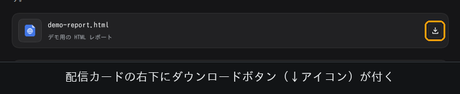
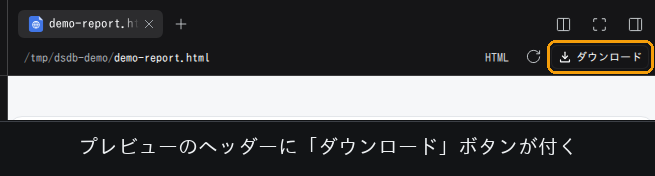
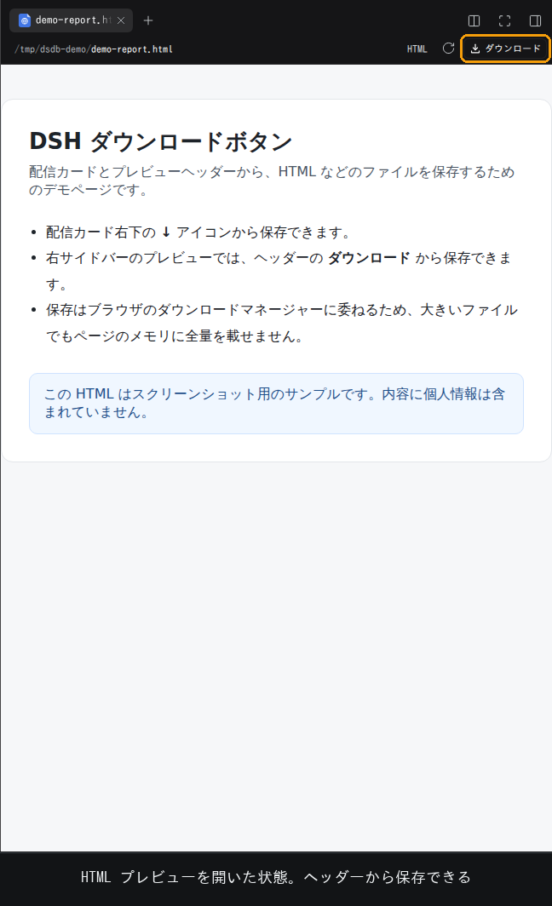

# dsh-download-button

DSH（DeepSeek Harness）Web GUI に**ダウンロードボタン**を追加するプラグインです。
`present` ツールが付ける**配信カード**と、右サイドバーの**ドキュメントプレビューのヘッダー**に
ボタンが付き、HTML・PDF・画像・Office 文書・Markdown・ソースコードなどをその場で保存できます。

- Host 側は認証付きの `GET /api/download.file` を 1 本追加するだけ
- Client 側は既存の slot にアンカーを 1 つ足すだけ
- ブラウザ標準のダウンロードマネージャーに渡すので、大きいファイルでもページのメモリに全量を載せない
- ワークスペースへの書き込みも、セッションへのイベント追加も行わない

## スクリーンショット

### 配信カードのダウンロードボタン

`present` で配信されたファイルのカード右下に、ダウンロードアイコンが付きます。



### プレビューヘッダーのダウンロードボタン

HTML などのプレビューを開くと、ヘッダーに「ダウンロード」ボタンが現れます。



### HTML プレビューを開いた状態

プレビューを開いたままでも、配信カードからも、どちらからでも保存できます。



## できること

| 場所 | ボタン | 保存できるもの |
|---|---|---|
| 配信カード（`present`） | 右下の ↓ アイコン | そのカードが指すファイル |
| 右サイドバーのプレビュー | ヘッダーの「ダウンロード」 | プレビュー中のファイル |

HTML だけでなく、Markdown・PDF・PNG/JPEG/SVG・Word/PowerPoint/Excel・CSV・ソースコードなど、
DSH がプレビューできるファイルなら何でも保存できます。

## インストール

このリポジトリは DSH の**バンドル**（`package.json` の `dsh.bundle.patch`）です。
Host 半分（`index.js`）と Client 半分（`client.js`）を 1 パッケージで持ちます。

### ローカルディレクトリから

```sh
dsh plugin --profile web add link:/absolute/path/to/dsh-download-button
```

### tarball から

```sh
dsh plugin --profile web add /absolute/path/to/dsh-download-button-0.1.0.tgz
```

### GitHub から（このリポジトリ）

```sh
dsh plugin --profile web add github:micachi/dsh-download-button
```

> プライベートリポジトリの場合は、`gh auth login` などで GitHub の認証情報が
> 入っている必要があります。

### 有効化と再読み込み

パッケージを追加しただけではバンドルは無効のままです。Web サイドバーの
**Plugins** を開き、`dsh-download-button` を有効化してください。

Host 側のルートは HMR で即時反映されます。インストール前から開いていたページで
ボタンが出ない場合は、**一度だけページを再読み込み**してください（ブラウザ側の
プラグイングラフの購読が切れている場合、新しいパッケージは再読み込みまで届きません）。

### エージェントから入れる場合

`plugin_manager` ツールの `install_bundle` に、パッケージの絶対パスを `target` として渡します。
`application: "applied"` が返れば有効化まで完了しています。

## 使い方

1. エージェントに HTML などを作らせ、`present` で配信させます。
2. 返信の下に配信カードが並ぶので、カード右下の ↓ アイコンを押します。
3. ブラウザのダウンロード先に、元のファイル名で保存されます。

プレビューから保存する場合は、カードをクリックして右サイドバーにプレビューを開き、
ヘッダーの「ダウンロード」を押します。

保存されるファイル名は、解決後のパスから作られます。日本語などの非 ASCII 名は
RFC 5987 の `filename*` で送るため、文字化けしません。

## 仕組み

```
Client                                   Host
──────                                   ────
配信カード  ── sessionId/seq/index ──▶  GET /api/download.file
プレビュー  ── absolute path ────────▶    │
                                          ├─ 合成ファイルシステムで解決
                                          ├─ 通常ファイル・サイズ上限を検証
                                          └─ 200 + Content-Disposition: attachment
```

- ルートは `connection.fetch.register` で、出荷済みの `/api/file` や
  `/api/present.open` と同じ認証フェンスの中に登録します。ブラウザのセッション
  クッキーで認証され、読み取り可否は合成ファイルシステムが決めます。
- 配信カードは、記録済みの `deliverables/presented` イベントを 1 回読み、
  宣言されたパスをセッションのワークスペースから解決します。出荷済みの
  「ネイティブで開く」ルートと同じ座標の解決方法です。
- プレビューは、Client が渡す実行環境の絶対パスをそのまま解決します。
- ボタンは同一オリジンの `<a download>` なので、JavaScript で全バイトを
  メモリに持たず、ブラウザのダウンロードマネージャーがストリームで保存します。

### 実測値（2026-11-01、DSH 0.2.1-rc.2 / Linux）

スクリーンショットと実測値は、デモ用の自己完結 HTML（`demo-report.html`）で取得しています。
個人の会話やローカルパスは含めていません。

- `GET /api/download.file?path=.../demo-report.html`
  → **200**、`Content-Disposition: attachment; filename="demo-report.html"`、
  **1,695 bytes が元ファイルと完全一致**
- 配信カード経由（`sessionId` + `seq` + `index`、`demo-report.html` のカード）
  → **200**、**1,695 bytes 一致**
- 未認証 → **401**、存在しないパス → **404**、ディレクトリ → **403**、相対パス → **400**
- 非 ASCII 名 `日本語 ファイル (1).html`
  → `filename*=UTF-8''%E6%97%A5%E6%9C%AC%E8%AA%9E%20...` で正しくエンコード

## 設定

| フィールド | 既定値 | 意味 |
|---|---|---|
| `maxBytes` | `67108864`（64 MiB） | ダウンロードで返すファイルの上限。超えると `413`。 |

プロファイルのパッチで上書きできます。

```yaml
- id: download-button
  config:
    maxBytes: 268435456
```

## 必要なサービス

Host 半分は次のサービスが構成に存在するときだけ有効になります（出荷済みの
Web プロファイルにはすべて含まれます）。

`connection` / `fs` / `sessionQuery` / `workspaceFiles` / `sandboxPolicy`

Client 半分は Web プラットフォーム向けで、次の出荷済みパッケージが宣言する
slot に参加します。

- `deliverables.file.actions` — `@deepseek-ai/dsh-client-ui-deliverables`
- `sidebar.right.tab.document.actions` — `@deepseek-ai/dsh-client-ui-sidebar-documentpreview`

slot の所有者がいない構成では、そのボタンは出ないだけで、プラグインは失敗しません。

## 制約

- ダウンロードは**ユーザー操作**です。エージェント用のツールは意図的に付けていません
  （ワークスペース外にコピーを作る操作になるため）。
- 合成ファイルシステムが読めるファイルだけを返します。ディレクトリ、拒否された
  シンボリックリンク、存在しないパスは `403` / `404` になります。
- 変更ファイルの差分レビュータブ（`deliverables.review.file.actions`）は未対応です。
  変更ファイルはサイドバーでプレビューしてから保存してください。
- `fs.readBytes` で読み込むため、`maxBytes` は 1 回のダウンロードのプロセスメモリ量の
  上限にもなります。信頼できる単独利用の環境でのみ上げてください。
- ページのプラグイングラフ購読がすでに終了している場合（Host の再起動後など）は、
  再読み込みするまで新しいパッケージが届きません。

## アンインストール

Plugins ページで `dsh-download-button` を無効化するか、次を実行します。

```sh
dsh plugin --profile web remove dsh-download-button
```

## English summary

A DeepSeek Harness plugin that adds a **Download** button to (1) the delivery
cards produced by the `present` tool and (2) the right-Sidebar document preview
header. Both buttons are same-origin anchors to one authenticated Host route,
`GET /api/download.file`, which answers with `Content-Disposition: attachment`
and streams the file through the composed filesystem. Install it as a bundle
with `dsh plugin --profile web add <spec>`, enable it on the Plugins page, and
reload a page that was open before the installation. See the Japanese sections
above for configuration, verified measurements, and limitations.

## License

MIT — see [LICENSE](./LICENSE).
